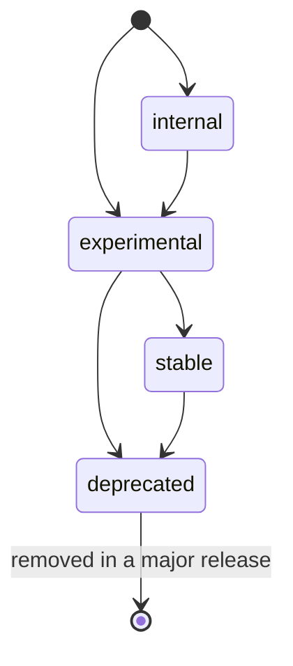
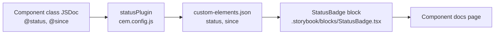

<!-- Generated breadcrumbs - DO NOT EDIT -->

[CONTRIBUTOR-DOCS](../README.md) / [Contributor guides](README.md) / Component status and since tags

<!-- Document title (editable) -->

# Component status and since tags

<!-- Generated TOC - DO NOT EDIT -->

<details open>
<summary><strong>In this doc</strong></summary>

- [Overview](#overview)
- [Status values](#status-values)
    - [`experimental`](#experimental)
    - [`stable`](#stable)
    - [`deprecated`](#deprecated)
    - [`internal`](#internal)
- [Changing a status](#changing-a-status)
- [The since tag](#the-since-tag)
    - [When to set it](#when-to-set-it)
    - [When to change it](#when-to-change-it)
    - [Icons](#icons)
- [How the tags reach the docs](#how-the-tags-reach-the-docs)
- [Checklist for reviewers](#checklist-for-reviewers)

</details>

<!-- Document content (editable) -->

## Overview

Every public gen2 component class carries two JSDoc tags that tell consumers how much to rely on it:

- `@status` says how stable the component is: `experimental`, `stable`, `deprecated`, or `internal`.
- `@since` records the first published version of `@adobe/spectrum-wc` that included the component.

Both tags sit in the JSDoc block on the component class in `gen2/packages/swc/components/<component>/<Component>.ts` (or the pattern class in `gen2/packages/swc/patterns/`), next to `@element`:

```ts
/**
 * A short description of the component.
 *
 * @element swc-my-component
 * @status experimental
 * @since 2.0.0-beta.8
 */
export class MyComponent extends MyComponentBase { … }
```

This doc defines what each value means, when the tags change, and who changes them. For how changes are announced, see [Changelog strategy](15_changelog-strategy.md). For how versions are produced, see [Releasing SWC](06_releasing-swc.md).

> **Scope:** These rules apply to component and pattern classes that consumers use directly. Base classes in `gen2/packages/core`, mixins, and controllers don't carry `@status` or `@since`. Member-level `@internal` (on a property or method) is a different thing: it hides a member from the API table and isn't governed by this doc.

## Status values

`@status` is required on every public component class. A missing tag is a review blocker, not a synonym for `stable`, because gen2 is still in pre-release and a missing tag can't tell "stable" apart from "not yet assessed".

| Value | What it means for consumers | Docs badge |
| --- | --- | --- |
| `experimental` | Usable in products, but the API, styling, or behavior can still change in a minor release. Pin versions and read the changelog before upgrading. | Experimental |
| `stable` | The public API is settled. Breaking changes happen only in a major release, and only after a deprecation period. | None |
| `deprecated` | Still works, but has a named replacement or is planned for removal. Don't adopt it in new work. It's removed only in a later major release. | Deprecated |
| `internal` | A building block for other SWC components. It isn't part of the public API and can change or disappear in any release. Don't use it directly. | Internal |

A component's status is independent of the package version. Gen2 publishes as `2.0.0-beta.N` and stays in changesets' persistent pre-release mode (see [Gen2's pre-release versioning](15_changelog-strategy.md#gen2s-pre-release-versioning)), but an individual component can still be `stable` once it meets the criteria below.

### `experimental`

New components start here. A component stays in `experimental` while any of these are true:

- Its public API (properties, attributes, slots, events, CSS custom properties) hasn't had a review.
- Its docs page, accessibility section, or migration guide is missing or incomplete.
- A breaking change to it is planned or under discussion.

### `stable`

A component moves to `stable` when all of these are true:

- Its public API has been reviewed and no breaking change is planned.
- Its per-component docs page is complete, including the accessibility section.
- It has a migration guide, if it replaces a 1st-gen component.

`stable` renders no badge on the docs page. The absence of a badge is the signal that the component is ready to depend on.

### `deprecated`

Marking a component `deprecated` requires all of these in the same PR:

- A named replacement, or an explicit "no replacement" statement, in the class JSDoc and on the docs page.
- A dev-mode deprecation warning, following [Deprecation warnings](../02_style-guide/02_typescript/17_debug-validation.md#deprecation-warnings).
- A changeset that describes the deprecation and includes a `Consumer action:` note (see [Rules](15_changelog-strategy.md#rules)).

A deprecated component is removed only in a later major release. Its removal is a breaking change and follows the `major` bump rules in [Bump types](15_changelog-strategy.md#bump-types).

### `internal`

Use `internal` for components that exist to build other SWC components and that consumers shouldn't place directly. An internal component's stories and docs use the `.internal.stories.ts` and `.internal.mdx` naming, which the production Storybook build excludes (see `gen2/packages/swc/.storybook/main.ts`).

Promoting an internal component to public means dropping the `.internal.*` naming and changing `@status` to `experimental`, in the same PR. The [Asset component plan](../03_project-planning/03_components/asset/component-plan.md) is an example.

## Changing a status

A status change is a consumer-facing commitment, so it needs a recorded decision and two kinds of sign-off.

1. **Decide.** The team agrees on the change, for example in triage or design review, and records the decision on the component's Jira ticket.
2. **Change the tag.** The PR author updates `@status` in the component class and links the Jira ticket in the PR description.
3. **Get sign-off.** The PR needs approval from a maintainer (engineering) and from design.
4. **Add a changeset.** Describe the new status from the consumer's point of view, following [Changelog strategy](15_changelog-strategy.md). For example: `` `Badge` — Marked as stable. No consumer action required. `` Use the bump type from the table below.

| Change | Bump type | Why |
| --- | --- | --- |
| `internal` to `experimental` | `minor` | A new public component becomes available. |
| `experimental` to `stable` | `patch` | The code doesn't change, only the commitment. |
| Any status to `deprecated` | `minor` | It adds a dev-mode warning and points consumers to a replacement. |
| Removing a `deprecated` component | `major` | It's a breaking change. |

While gen2 is in pre-release, every release becomes the next `2.0.0-beta.N` whatever the bump type, so for now the bump type only decides which changelog section the entry appears under.

The allowed transitions are:



A `stable` component never goes back to `experimental`. If its API needs a breaking change, deprecate the affected API and ship the replacement, or plan the change for a major release.

## The since tag

`@since` records the first published version of `@adobe/spectrum-wc` that included the component, for example `2.0.0-beta.3`. It's the gen2 package version, not the 1st-gen version of the component it replaces.

### When to set it

- **New component:** Add `@since next` in the PR that adds the component. Don't guess the version number. Gen2 versions come from the Version PR (see [Planned release (Version PR)](06_releasing-swc.md#planned-release-version-pr)), so the author can't know which `2.0.0-beta.N` will ship the component.
- **At release:** The release-stamping automation tracked in SWC-2558 replaces `next` with the version that publishes the component. Until that automation exists, `next` stays in place and the docs keep the "Since" badge hidden.

### When to change it

Never, once the component is released. Renames, status changes, and new features don't change `@since`. It always points at the component's first release.

`@since` applies to the component class only. Don't add it to individual properties, attributes, slots, or events.

### Icons

The generated icon elements in `gen2/packages/icons/src/` follow the same rule: `@since` records the first published version that included the icon, a new icon gets `@since next`, and a released icon's `@since` never changes. Contributors don't set it by hand. The generator in `gen2/packages/icons/scripts/generate-workflow-icons.mjs` writes it and keeps each existing icon's value. See the [icon source README](../../gen2/packages/icons/icon-source/README.md).

> **Note:** The generator currently gives new icons the last published package version instead of `next`. Updating it to match this rule is planned follow-up work.

## How the tags reach the docs



1. `statusPlugin` in `gen2/packages/swc/cem.config.js` reads the last JSDoc block on each class declaration and copies the `@status` and `@since` values onto that class's entry in the Custom Elements Manifest (`gen2/packages/swc/dist/custom-elements.json`).
2. The `StatusBadge` block in `gen2/packages/swc/.storybook/blocks/StatusBadge.tsx`, rendered by `DocsHeader`, finds the manifest entry whose `tagName` matches the story meta's `component` and renders the badges.
3. `StatusBadge` renders a badge for `experimental`, `deprecated`, and `internal` only. Any other value, including `stable`, renders no status badge.
4. The "Since" badge is hidden by default (`showSince = false`). It turns on once the SWC-2558 automation keeps `@since` accurate, and that work also needs to keep the `next` placeholder from rendering.

The manifest is rebuilt with the package (`yarn build`), so a tag change shows up in Storybook after the next build.

## Checklist for reviewers

- [ ] Every new public component class has `@status` and `@since`.
- [ ] A new component's `@since` is `next`, not a guessed version.
- [ ] A released component's `@since` hasn't changed.
- [ ] A status change links a Jira decision, has maintainer and design approval, and has a changeset with the right bump type.
- [ ] A `deprecated` status comes with a replacement (or "no replacement"), a dev-mode warning, and a changeset with a `Consumer action:` note.
