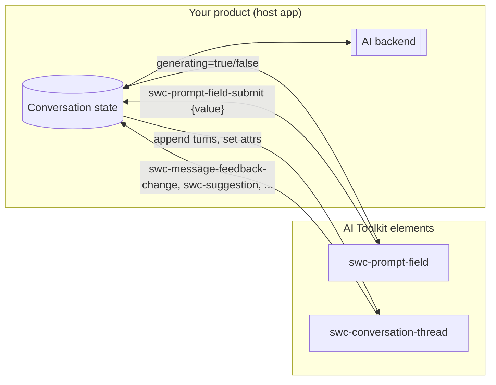
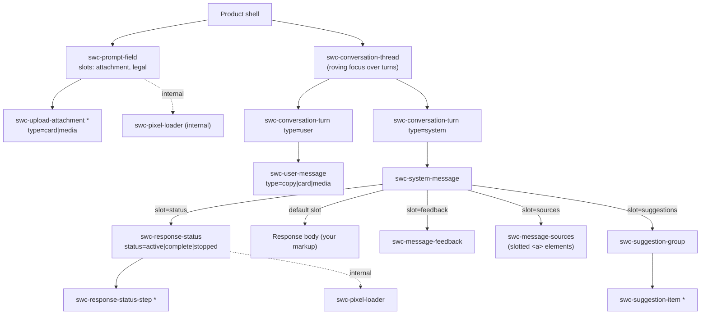

# AI Toolkit onboarding guide

Goal: by the end of this guide you can open any file in `gen2/packages/swc/patterns/ai-toolkit/`, say what it does, how it fits, and who owns its state.

---

## 1. Mental model (read this first)

Think of the toolkit as **dumb views and a smart host**.

- The elements render the chat UI and emit `swc-*` events.
- **Your product (the host)** owns the conversation: it listens for events, calls the model, appends turns to the DOM, and flips attributes (`generating`, `status`).
- No element talks to an AI backend. No element stores the message list.



---

## 2. Composition tree



Rules worth memorizing:

1. `swc-prompt-field` sits **outside** the thread, as a sibling.
2. A `system-message` always paints its slots in a fixed order (status → body + feedback → sources → suggestions), whatever order you write them in.
3. Attachments inside the prompt field must all share one `type` (card or media). Mixing them logs a dev warning.
4. The prompt field logs a dev warning if the `legal` slot is empty.
5. Only the **latest** system turn should show suggestions. Your product has to remove the old ones.

---

## 3. The generation lifecycle (the part the docs don't show)

This is reconstructed from the `FullPattern` story (`conversation-thread/stories/conversation-thread.stories.ts:277-760`), the only end-to-end example in the repo.

```mermaid
sequenceDiagram
  autonumber
  actor U as User
  participant PF as swc-prompt-field
  participant H as Product host
  participant TH as swc-conversation-thread
  participant RS as swc-response-status

  U->>PF: types, presses Enter
  PF->>H: swc-prompt-field-submit {value}
  H->>TH: append user turn + system turn
  H->>RS: status="active" (slot=status)
  H->>PF: generating=true (send becomes stop)
  loop streaming
    H->>RS: append/update swc-response-status-step (status=active→complete)
    H->>TH: update body text
  end
  alt user stops
    U->>PF: clicks stop
    PF->>H: swc-prompt-field-stop
    H->>RS: status="stopped"
  else completes
    H->>RS: status="complete"
  end
  H->>PF: generating=false
  H->>TH: add feedback, sources, suggestions to latest system turn; remove old suggestions
  U->>TH: clicks suggestion
  TH->>H: swc-suggestion {label}  (treat like a submit)
```

Gotchas from the demo:

- The demo clears the prompt and attachments on submit. The prompt field doesn't do this for you.
- The demo re-renders turns without Lit `repeat()` keys. Copying that pattern can break roving focus when turns are replaced (see audit #14).
- Scroll-to-bottom is the host's job (demo `:324-337`).

---

## 4. State ownership: the main source of confusion

Each element handles "who changes the attribute" differently. Check this table before wiring anything.

| Element                    | Attribute    | Who updates it after user action                                                                               | Model                    |
| -------------------------- | ------------ | -------------------------------------------------------------------------------------------------------------- | ------------------------ |
| `swc-message-feedback`     | `status`     | **You.** The click only fires `swc-message-feedback-change`; the thumbs don't light up until you set `status`. | Controlled               |
| `swc-message-sources`      | `open`       | **The element** flips `open`, then fires `swc-message-sources-toggle`.                                         | Self-managed + notify    |
| `swc-response-status`      | `open`       | **The element** flips `open`, then fires `swc-response-status-toggle`.                                         | Self-managed + notify    |
| `swc-response-status-step` | `open`       | **The element.** The parent re-fires it as `swc-response-status-step-toggle {open, index}`.                    | Self-managed + notify    |
| `swc-response-status`      | `status`     | **You** (active → complete/stopped).                                                                           | Controlled               |
| `swc-prompt-field`         | `value`      | **The element** mirrors typing into `value` and fires `swc-prompt-field-input`. You can also set it.           | Uncontrolled with mirror |
| `swc-prompt-field`         | `generating` | **You.** Submit and stop only fire events.                                                                     | Controlled               |
| `swc-upload-attachment`    | (removal)    | **You.** Dismiss fires `swc-upload-attachment-dismiss {attachment}`; you remove the node.                      | Controlled               |

Vocabulary mismatch to watch: the prompt field uses a boolean `generating`, but response status uses `status="active|complete|stopped"`. Both describe the same moment.

> **How React Spectrum does it.** React Spectrum uses one rule for every stateful piece: a controlled prop, an uncontrolled `default*` prop, and an `on*Change` callback (for example, feedback `value`/`defaultValue`/`onChange`, and disclosure `isExpanded`/`defaultExpanded`/`onExpandedChange`). Learn the rule once and it applies everywhere. The SWC equivalent would be "the element updates itself, then fires a cancelable event", which gen2 tabs and accordion already do. See [`05-react-spectrum-comparison.md`](./05-react-spectrum-comparison.md) §2.
>
> **Accessibility gap to know about.** The toolkit doesn't announce when an answer arrives, and the thread has no role or name (audit #31, #32). If you're building a product on it today, plan your own live-region announcement.

---

## 5. Event cheat sheet

All events bubble and are composed, so you can listen once at the app shell.

| Event                             | From                                  | `detail`                                            | Cancelable                                                                                                                        |
| --------------------------------- | ------------------------------------- | --------------------------------------------------- | --------------------------------------------------------------------------------------------------------------------------------- |
| `swc-prompt-field-submit`         | prompt-field                          | `{ value }`                                         | no                                                                                                                                |
| `swc-prompt-field-input`          | prompt-field                          | `{ value }`                                         | no                                                                                                                                |
| `swc-prompt-field-stop`           | prompt-field                          | none                                                | no                                                                                                                                |
| `swc-prompt-field-upload-click`   | prompt-field                          | none                                                | Flagged `cancelable`, but there's no default action, so `preventDefault()` does nothing (audit #9). Open your own picker or menu. |
| `swc-prompt-field-drop`           | prompt-field                          | `{ files: File[] }`                                 | no                                                                                                                                |
| `swc-upload-attachment-dismiss`   | upload-attachment                     | `{ attachment }`                                    | no                                                                                                                                |
| `swc-response-status-toggle`      | response-status                       | `{ open }`                                          | no                                                                                                                                |
| `swc-response-status-step-toggle` | response-status (on behalf of a step) | `{ open, index }`                                   | no                                                                                                                                |
| `swc-message-feedback-change`     | message-feedback                      | `{ status: 'positive' \| 'negative' \| undefined }` | no                                                                                                                                |
| `swc-message-sources-toggle`      | message-sources                       | `{ open }`                                          | no                                                                                                                                |
| `swc-suggestion`                  | suggestion-item                       | `{ label }`                                         | no                                                                                                                                |

---

## 6. How a pattern differs from a component

|                 | Component (for example `badge`)                              | Pattern element (for example `prompt-field`)                                   |
| --------------- | ------------------------------------------------------------ | ------------------------------------------------------------------------------ |
| Base class      | `core/components/<x>/<X>.base.ts` + concrete class in `swc/` | **None.** The class extends `SpectrumElement` directly, all in `swc/patterns/` |
| Location        | `swc/components/<x>/`                                        | `swc/patterns/ai-toolkit/<unit>/` (one level deeper)                           |
| Storybook title | `Components/<Name>`                                          | `Patterns/AI Toolkit/<Name>` (the prefix comes from `main.ts`)                 |
| Docs extras     | none                                                         | `## Full pattern` section allowed; group-level `pattern-overview.mdx`          |
| Import path     | `@adobe/spectrum-wc/components/<x>/...`                      | `@adobe/spectrum-wc/patterns/ai-toolkit/<unit>/swc-<unit>.js`                  |

### Per-unit file anatomy

```
<unit>/
├── <ClassName>.ts         # class extends SpectrumElement; JSDoc @element/@slot/@fires/@cssprop
├── swc-<tag>.ts           # defineElement('swc-<tag>', Class) + HTMLElementTagNameMap  ← import THIS to register
├── index.ts               # re-exports the class only (no registration)
├── <unit>.css
├── <unit>.mdx             # docs page (sections validated by yarn lint:docs-pages)
├── stories/<unit>.stories.ts
└── test/
    ├── <unit>.test.ts
    ├── <unit>.a11y.spec.ts
    └── vrt/<unit>.vrt.ts  # missing for 5 units, see audit
```

Exceptions:

- `response-status/response-status-step/` is nested inside its parent and has **no** MDX, stories, or tests of its own.
- `suggestion/` folder → `swc-suggestion-group` (the folder name and the tag don't match).
- `pixel-loader/` is internal: `.internal.mdx` and `.internal.stories.ts`.
- `utils/icons/index.ts` holds inline SVG template factories. The adjacent `.svg` files are unused.

### Build and tooling wiring (so you know where to look when something isn't picked up)

| Concern           | File                                                   | What it does                                                                                      |
| ----------------- | ------------------------------------------------------ | ------------------------------------------------------------------------------------------------- |
| Bundle entries    | `gen2/packages/swc/vite.config.ts:132-139`             | Globs `patterns/*/*/index.ts`, `patterns/*/*/swc-*.ts`, plus one deeper level for the nested step |
| Import alias      | `vite.config.ts:197-202`                               | `@adobe/spectrum-wc/patterns`                                                                     |
| Package exports   | `gen2/packages/swc/package.json:51-61`                 | `./patterns/*`                                                                                    |
| CEM (API docs)    | `gen2/packages/swc/cem.config.js:73`                   | `patterns/**/*.ts`                                                                                |
| Storybook         | `.storybook/main.ts:86-89`, `preview.ts:~237-250`      | `PATTERN_STORIES` directory, `Patterns` title prefix, overview sorted first                       |
| Source snippets   | `.storybook/utils/docs-source-transform.ts`            | Strips CSF wrappers for `Patterns/AI Toolkit/*`                                                   |
| Docs lint         | `scripts/validate-docs-pages.js:146-160`               | Pattern genre; skips `pattern-overview.mdx` and sentence-case checks                              |
| Consumer AI skill | `scripts/generate-agent-skills.mjs:521-570, 1214-1294` | Publishes every pattern MDX + overview into `spectrum-wc-skill`                                   |

---

## 7. Where to start reading code (suggested 90-minute path)

1. **10 min:** `conversation-turn/ConversationTurn.ts` + `user-message/UserMessage.ts`. They're small and show the house style.
2. **10 min:** `system-message/SystemMessage.ts`. Purely structural; shows the slot contract.
3. **15 min:** `message-feedback/MessageFeedback.ts`. The controlled model plus `FocusgroupNavigationController`.
4. **15 min:** `conversation-thread/ConversationThread.ts`. Roving focus across turns.
5. **20 min:** `response-status/ResponseStatus.ts` + `response-status-step/ResponseStatusStep.ts`. The parent/child contract (internal events, `labelText` getter, MutationController).
6. **20 min:** `conversation-thread/stories/conversation-thread.stories.ts:277-760` (`ConversationFullPatternDemo`). This shows how it all wires together.
7. **Later:** `prompt-field/PromptField.ts` (1,312 lines). Read it in this order: properties `120-200` → events `358-433` → render `1069-1312` → attachment focus logic `477-970`.

---

## 8. Commands

```bash
yarn build                 # full build (required once per session)
yarn test                  # unit + a11y tests
yarn lint:docs-pages       # MDX section-order and story-reference validation
yarn lint                  # eslint/stylelint/prettier
```

Storybook: the sidebar shows **Patterns → AI Toolkit → Conversational pattern overview** first, then the elements alphabetically.
