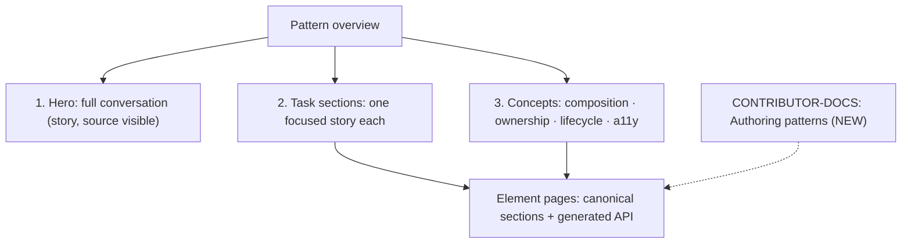

# AI Toolkit docs: why they're hard to follow, and how to fix them

**Guiding rule: docs carry concepts, and stories carry code.** Story source panels are generated from the render (`docs.source.type: 'dynamic'` in `.storybook/preview.ts`), and API tables are generated from CEM (`DocsFooter`). Anything hand-typed that duplicates either one will drift. Seven of the current 🔴 items are exactly that kind of drift. So MDX prose should explain _how the pieces fit, who owns what, and which story to look at_, and never restate signatures, import paths, or code.

## 1. Diagnosis: six reasons the docs don't land

1. **No "how it fits together" story.** The overview opens with the right idea, a hero example (React Spectrum does the same). But the hero hides its code (`sourceState="none"`), its code panel is a hand-typed string (audit #36), and the real wiring lives in a 480-line `LitElement` in a stories file.
2. **State ownership is implicit.** No page says which attributes _you_ set and which the element sets for itself. You have to learn three models by trial and error (audit #10).
3. **Organized by element, not by task.** People arrive with a task ("add attachments", "show progress"). The sidebar lists 13 element names. React Spectrum organizes the same family by task, and it reads much faster.
4. **Uneven element pages.** `conversation-thread` and `conversation-turn` have only `## Accessibility`. `upload-attachment` uses `## Usage`. You can't predict where to find something.
5. **Docs drift.** Hand-written claims don't match the code (audit #1–7, #36). Once a reader catches one, they stop trusting the rest.
6. **No contributor guide.** Nothing explains "patterns have no Base class, here's why, here's how to add one".

## 2. Recommended structure (task-first, concepts in prose, code in stories)

Modeled on React Spectrum's AI page: hero → task sections → reference. Adapted for SWC: every code sample is a story's generated source panel, and nothing is typed into the MDX.

### 2a. Overview page: three parts

**Part 1: Hero.** Keep `FullPattern` at the top, but make its code readable:

- Replace the hand-typed `fullPatternSource` with generated source (audit #36). If the full demo is too dynamic for that, show its _initial state_ as a generated story and link the demo.
- Move `ConversationFullPatternDemo` into its own file (`conversation-thread/stories/full-pattern-demo.ts`) so it's linkable and readable as reference code, and fix the unkeyed `repeat()` (audit #14). The demo file _is_ the integration example. It's compiled and type-checked, so it can't silently drift the way prose can.

**Part 2: Task sections.** Each one is a heading in verb form, two or three sentences of _why/when_, and one `<Canvas>` with the source visible:

| Task section                      | Story to show (exists today unless marked)                  | Concept the prose must state                                                                  |
| --------------------------------- | ----------------------------------------------------------- | --------------------------------------------------------------------------------------------- |
| Send a prompt and show progress   | `PromptField/States`, `ResponseStatus` stories              | The host sets `generating`, then `status`, and the prompt field turns send into stop.         |
| Stop or fail a generation         | `ResponseStatus` stopped (**new**: failed, after audit #33) | Who flips which state on stop; what the user sees.                                            |
| Offer follow-up suggestions       | `SuggestionGroup` stories                                   | Recommended handling is **prefill the prompt, let the user send** (React Spectrum precedent). |
| Attach files                      | `PromptField/Attachment`, `DragAndDrop`                     | The host owns the attachment elements, and the toolkit only emits intent events.              |
| Collect feedback and show sources | `MessageFeedback`, `MessageSources` stories                 | Feedback is controlled: the element won't flip itself today.                                  |

**Part 3: Concepts** (prose and diagrams only, no code). These change slowly because they describe the design, not the API:

1. **Composition tree**: React Spectrum opens each compound API with a tiny nesting tree. Do the same here (copy from `01-onboarding-guide.md` §2). Tag names only, no attributes.
2. **Who owns what**: a table of _concepts_, not signatures: "prompt text: element", "generating: you", "disclosure open: element, then notifies". Point to each element's API table for the exact names.
3. **Lifecycle**: the sequence diagram from `01-onboarding-guide.md` §3.
4. **Accessibility contract**: what the toolkit announces and what the host must do (focus after submit, scroll). This depends on fixing audit #31 and #32 first. React Spectrum shows what a complete contract looks like.
5. Fix line 85 (audit #2), and rename the Meta title to `AI Toolkit/Pattern overview` (audit #1).

**Removed from earlier drafts on purpose:** the imports table, per-step code samples, an i18n string table, and an events table with `detail` shapes. All of these duplicate CEM or the code and would drift. For imports, state the _rule_ once ("each element registers from `…/<unit>/swc-<tag>.js`"), and fix the one folder that breaks the rule (audit #26) instead of documenting the exception. Events and their details are already in each page's generated API table.

### 2b. Normalize element pages

Every page follows the canonical order: **Anatomy → Options → States → Behaviors → Accessibility → API**. Each section is a short concept paragraph plus a story. Signatures belong in the generated API, not in the prose.

| Page                      | Missing today                           | Add                                                                                                                          |
| ------------------------- | --------------------------------------- | ---------------------------------------------------------------------------------------------------------------------------- |
| `conversation-thread.mdx` | Anatomy, Behaviors                      | Anatomy; Behaviors (roving focus, newest-turn re-entry)                                                                      |
| `conversation-turn.mdx`   | Anatomy, Options                        | Anatomy; Options (`type`)                                                                                                    |
| `upload-attachment.mdx`   | Anatomy, Accessibility; uses `## Usage` | Rename to Anatomy/Options; add Accessibility                                                                                 |
| `system-message.mdx`      | Behaviors                               | Behaviors: the fixed slot paint order                                                                                        |
| `message-sources.mdx`     | Behaviors                               | Behaviors: self-managed `open`; replace sources rather than mutating them                                                    |
| Every page with events    | —                                       | One sentence under Behaviors: "**who updates state** after this event." The event names and details come from the API table. |

### 2c. Guardrails against drift

1. **`scripts/validate-docs-pages.js`**: stop skipping `pattern-overview.mdx`, turn on sentence-case checks for patterns, and require `Anatomy`.
2. **No static `source.code` strings in pattern stories** unless a test verifies their tags and attributes against CEM.
3. **JSDoc is docs too**: CEM, the API tables, _and_ the consumer AI skill read it (audit #5). Review it like prose.

### 2d. Contributor side

1. **`gen2/packages/swc/AGENTS.md`**: a short "Patterns" section covering location, no Base class, the file anatomy, and where the tooling globs live.
2. **New `CONTRIBUTOR-DOCS/…/authoring-patterns.md`**: why patterns skip core; the state-ownership convention (self-update + cancelable event, matching gen2 tabs/accordion and React Spectrum's controlled/uncontrolled pairs; see 05 §2); the host-ARIA lifecycle convention (audit #20); nested sub-elements.
3. **`16_gen2-shared-resources.md`**: fix `upload-artifact` (audit #4).

## 3. Suggested PR sequence

| PR  | Scope                                                                        | Size               | Audit items |
| --- | ---------------------------------------------------------------------------- | ------------------ | ----------- |
| 1   | `docs(ai-toolkit): fix stale and broken references`                          | ~30 lines, 6 files | #1–7        |
| 2   | `docs(ai-toolkit): show generated hero source and extract full-pattern demo` | story refactor     | #14, #36    |
| 3   | `docs(ai-toolkit): restructure overview into hero, tasks, and concepts`      | 1 MDX              | §2a         |
| 4   | `docs(ai-toolkit): normalize element page sections`                          | 5 MDX              | §2b         |
| 5   | `docs(contributor): add authoring-patterns guide and lint guardrails`        | 3–4 files          | §2c, §2d    |

PR 1 is a safe first step: pure corrections, each one verified against code, reviewable in about 10 minutes. PR 3 should wait on decisions about audit #31–33, so the accessibility concept section describes the real contract.

## 4. Reminder: docs are also agent input

`scripts/generate-agent-skills.mjs` copies every pattern MDX page, plus `pattern-overview.mdx`, into the published `spectrum-wc-skill`. Concept-level prose ages well in that skill. Hand-typed signatures go stale for product teams' agents too. Today a coding agent would learn the nonexistent `loading`/`generation-complete` modes and wire them up.
