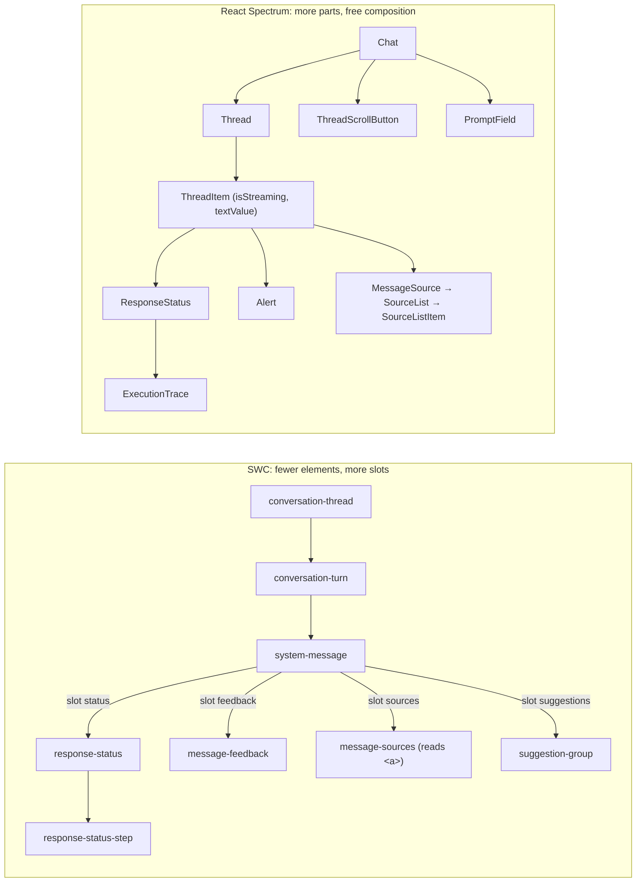
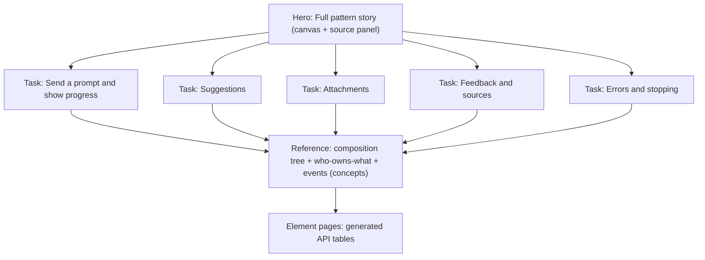

# AI Toolkit vs. React Spectrum AI components

Source: https://react-spectrum.adobe.com/ai-components (`@react-spectrum/ai`), read in full, including the API tables.
Snapshot only: both libraries are moving. This file compares **concepts and conventions**, not prop-by-prop signatures, so it stays useful after either API changes. For current signatures, check the React Spectrum page or the SWC Storybook docs (the generated API tables and the story source panels).

## TL;DR: verdicts

| #   | React Spectrum idea                                                                                                                                      | Verdict                       | One-line reason                                                                                                                             |
| --- | -------------------------------------------------------------------------------------------------------------------------------------------------------- | ----------------------------- | ------------------------------------------------------------------------------------------------------------------------------------------- |
| 1   | Every stateful piece uses the same controlled + uncontrolled pair (`value`/`defaultValue`/`onChange`, `isExpanded`/`defaultExpanded`/`onExpandedChange`) | ✅ Adopt (as a rule)          | This is the fix for audit #10. One rule replaces three models.                                                                              |
| 2   | Streaming-aware announcements on thread items (`isStreaming`, `textValue`, announce on mount)                                                            | ✅ Adopt                      | SWC has no live region for new content (audit #31, #32). This is the largest a11y gap.                                                      |
| 3   | `failed` response status + an `Alert` that can sit in the thread or the prompt field                                                                     | ✅ Adopt                      | SWC can't express "generation errored". The only options are `active`, `complete`, and `stopped`.                                           |
| 4   | Suggestions **prefill** the prompt; the app decides whether to submit                                                                                    | ✅ Adopt (docs and demo)      | SWC already only emits an event. Document prefill as the recommended handling.                                                              |
| 5   | Docs organized by **task** (prompt fields, suggestions, attachments, threads, loaders) with one hero example on top                                      | ✅ Adopt                      | Matches how people arrive ("I need attachments"), and maps onto stories SWC already has.                                                    |
| 6   | Sources composed from child items (auto-numbered list items) instead of reading slotted anchors                                                          | 🤔 Consider                   | Removes audit #8 and #17 by design, but it's a breaking change. Keep it for the next major.                                                 |
| 7   | Thread-level scroll management (pin to bottom while streaming, scroll-to-latest button, load-more)                                                       | 🤔 Consider                   | Every consumer re-implements this today. Start with a documented recipe, then decide whether to build it in.                                |
| 8   | Status vocabulary `pending` / `success` / `failed`                                                                                                       | 🤔 Consider (vocabulary only) | Aligning names across Spectrum helps, but `stopped` is a real SWC state that React lacks. Map them in docs now; rename only in a major.     |
| 9   | Upload progress on attachments                                                                                                                           | 🤔 Consider                   | Useful, low risk, and additive. Ship it when a product asks.                                                                                |
| 10  | Rich prompt input: tokens, `@`/`/` completions, insert menu, commands, voice button                                                                      | ⏸ Skip for now                | Large scope (custom editor, combobox, speech). Track it as a separate initiative; don't let it block convergence.                           |
| 11  | Separate package (`@react-spectrum/ai`)                                                                                                                  | ⏸ Skip                        | SWC already isolates the toolkit under `patterns/ai-toolkit/` with its own export paths. No consumer benefit for the churn.                 |
| 12  | Collection-driven thread (`items` + render function)                                                                                                     | ⏸ Skip                        | A React idiom. In web components, light-DOM children are the collection. Keep composition, but fix keyed rendering in the demo (audit #14). |

## 1. Element mapping

Same family, different granularity. React splits more pieces into separate components. SWC folds them into slots and attributes.

| Concept           | SWC (`swc-*`)                             | React Spectrum                                                                          | Note                                                                                      |
| ----------------- | ----------------------------------------- | --------------------------------------------------------------------------------------- | ----------------------------------------------------------------------------------------- |
| Chat shell        | No equivalent (consumer layout)           | `Chat`                                                                                  | React groups thread, scroll button, and prompt field.                                     |
| Thread            | `conversation-thread`                     | `Thread`                                                                                | React: labeled, keyboard-navigable collection. SWC: roving focus, but no role or name.    |
| Turn / row        | `conversation-turn` (`type=user\|system`) | `ThreadItem`                                                                            | React's row carries the streaming state and the announcement text.                        |
| User bubble       | `user-message`                            | `UserMessage`                                                                           | Equivalent.                                                                               |
| Assistant body    | `system-message` (fixed slots)            | Free children + `prose()` styling                                                       | SWC enforces paint order through slots; React leaves it to the author.                    |
| Thinking / status | `response-status`                         | `ResponseStatus` + `ResponseStatusTitle` + `ResponseStatusPanel`                        | Same idea. React splits the header and panel into parts.                                  |
| Steps             | `response-status-step` (nested folder)    | `ExecutionTrace` > `ExecutionTraceItem`                                                 | React's naming describes intent ("trace of tool calls"). Steps can expand to show detail. |
| Error             | none                                      | `Alert` (in thread or field)                                                            | Gap. See verdict 3.                                                                       |
| Feedback          | `message-feedback` (`status`)             | `MessageFeedback` (`value`)                                                             | Both controlled. React also supports uncontrolled and toggling off.                       |
| Sources           | `message-sources` (reads slotted `<a>`)   | `MessageSource` > `SourceList` > `SourceListItem`                                       | See verdict 6.                                                                            |
| Suggestions       | `suggestion-group` + `suggestion-item`    | `MessageSuggestionList` + `MessageSuggestion`                                           | Equivalent shape. React's examples prefill rather than submit.                            |
| Prompt input      | `prompt-field` (one element, plain text)  | `PromptField` > `PromptTokenField` + `PromptFieldToolbar` + `PromptFieldAttachmentList` | React is a compound component with a rich value model.                                    |
| Attachment        | `upload-attachment` (`type=card\|media`)  | `Attachment` + `AttachmentPreview`                                                      | React adds upload progress.                                                               |
| Disclaimer        | `prompt-field` `legal` slot               | `PromptField` disclaimer prop                                                           | Same intent.                                                                              |
| Loader            | `pixel-loader` (internal)                 | `PixelLoader` (public, with icon and preset exports)                                    | Same artwork system. React exposes it publicly.                                           |

## 2. State model: React's main lesson

React Spectrum applies **one rule everywhere**: each piece of state has a controlled prop, a `default*` uncontrolled prop, and an `on*Change` callback. You never have to look up how a particular element behaves.

| State                       | SWC today                                         | React Spectrum                                                 | Proposed SWC rule                                                                      |
| --------------------------- | ------------------------------------------------- | -------------------------------------------------------------- | -------------------------------------------------------------------------------------- |
| Prompt text                 | Uncontrolled; mirrored in `value`                 | Controlled or uncontrolled                                     | Element owns it, and `value` is settable. Event on change. ✅ already close            |
| Generating                  | Controlled `generating`                           | Controlled `isGenerating`                                      | Host owns it. ✅ same                                                                  |
| Feedback                    | Controlled only (the element doesn't flip itself) | Controlled or uncontrolled; toggle-off → `null`                | Let the element self-update, emit a cancelable change event, and support toggle-off.   |
| Sources / status disclosure | Self-managed `open` + toggle event                | `isExpanded` / `defaultExpanded` / `onExpandedChange`          | ✅ already the "self-manage, then notify" half. Document that `open` is also settable. |
| Attachments                 | Host adds and removes elements; dismiss event     | Controlled list or default list, with add and remove callbacks | Keep the host-owned light DOM, and document it as the convention.                      |

**Translating it to web components:** "self-update, then dispatch a cancelable event; the host can `preventDefault()` to veto, or set the property to take control." That covers controlled and uncontrolled use with a single mental model. gen2 core components already use cancelable events this way (tabs `change`, accordion-item toggle, alert-banner `close`), so the toolkit would be joining an existing convention rather than inventing one. Adopting it closes audit #9 and #10 together.

## 3. Accessibility: where React is ahead

1. **Streaming announcements.** React's thread item knows whether it's streaming and what text to announce. SWC's only live region is a `role="status"` on the response-status trail. It applies only while `active`, only when the status has no steps (the expandable header is a `<button>`, with no live region), and it's removed on `complete`. The final answer arriving is never announced (audit #32).
2. **Thread semantics.** React's thread takes an accessible name and is a navigable collection. SWC's thread renders a bare `
` with no role or name (audit #31).
3. **Errors.** React's `Alert` gives failures an announced, styled home. SWC has no error affordance.

SWC is equal or ahead in a few places: turn-level `role="group"` with a speaker label, roving focus across turns, and the drag-and-drop keyboard fallback guidance in `prompt-field.mdx`.

## 4. Docs: what to borrow (and what not to)

What React Spectrum does well:

1. **A hero example first.** A complete, working chat sits at the top, then short task sections, each with one focused example. Readers learn from what they can see before they read any API.
2. **Task-based headings.** Prompt fields → Suggestions and tokens → Attachments and actions → Chat threads → Loaders. These are verbs a product engineer is searching for, not element names.
3. **Composition trees in the API section.** Each compound component opens with a tiny nesting tree (`<Thread><ThreadItem/>…`) before its props table. It's the fastest way to understand slots and children.
4. **One page for the family.** All AI components live on a single page with a shared API section. There's no hopping between 14 docs pages to see how the pieces fit.

What not to copy:

1. Hand-written code in prose. React's examples are live, and their source is the example itself. SWC gets the same benefit from story source panels (`docs.source.type: 'dynamic'` in `.storybook/preview.ts`), so **the docs should point at stories, not repeat their code**.
2. Exhaustive DOM-handler rows in the API tables. They bury the 3–5 props that matter. SWC's CEM-driven `DocsFooter` is already leaner.

How this changes the recommendations is in [`04-docs-recommendations.md`](./04-docs-recommendations.md).

## 5. Open questions for the team

1. Should SWC and React Spectrum converge on one status vocabulary, and is `stopped` worth proposing upstream?
2. Do we want the rich prompt input (tokens, completions, voice) in SWC, and who owns it?
3. Should thread scroll pinning be built in or documented as a recipe? React built it in.
4. Should `pixel-loader` become public, as it is in React Spectrum?
