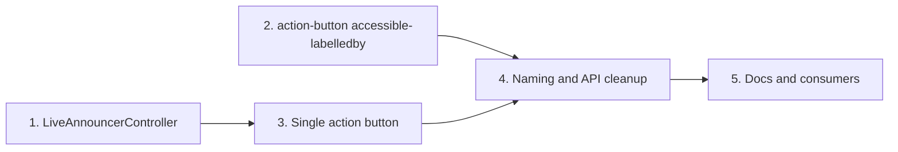

# SWC-2599 execution plan: prompt field accessible names

Ticket: [SWC-2599](https://jira.corp.adobe.com/browse/SWC-2599) "[AI Toolkit - Prompt Field] Set accessible names for AI mark and submit button"
Epic: SWC-2538 (Prompt Field Refinements). Related: SUE-379 (design docs, done). Fix version: `ai-toolkit:October` (release 2026-10-19).

This plan is new. It doesn't change docs 01–05; it cites them by section and issue number.

---

## 1. TL;DR

1. The textarea label is broken today: `aria-labelledby` points at a hidden "Prompt" span, so `accessible-label` never applies (the MDX says it does).
2. Send and stop are two separate buttons, so the swap destroys the focused element. Merge them into one persistent button first; most DoD items get easier after that.
3. Build two reusable pieces instead of one-off wiring: a `LiveAnnouncerController` (core) and `accessible-labelledby` support on `swc-action-button`, aligned with the forms RFC `LabellingMixin`.
4. Collapse the label props into a clear set and adopt one naming convention: `accessible-label` names the component, `<part>-accessible-label` names an internal part. Drop `label`, keep `accessible-label` (now names the AI mark), and rename `send-label` to `submit-accessible-label` plus five more. See [section 7.1](#71-naming-convention-for-accessible-names).
5. Three decisions block step 3 onward. See [section 5](#5-open-decisions).

---

## 2. Definition of done, restated

| #   | DoD item                                                                     | Status today                                                                  |
| --- | ---------------------------------------------------------------------------- | ----------------------------------------------------------------------------- |
| 1   | AI mark exposes "AI prompt"                                                  | Missing. Mark wrapper is `aria-hidden="true"`                                 |
| 2   | Submit button exposes "Submit AI prompt"                                     | Exposes "Send"                                                                |
| 3   | Thinking state: button exposes "Stop"                                        | Exposes "Stop generating" on a different element                              |
| 4   | Name change on the swap is announced                                         | Not announced. Focus is lost instead                                          |
| 5   | Textarea and button get names through `aria-labelledby` to the right element | Textarea uses `aria-labelledby` to the hidden label. Button uses `aria-label` |
| 6   | Names verified in the browser accessibility tree                             | Not done                                                                      |
| 7   | A11y tests cover names and `aria-labelledby` wiring                          | Snapshots assert "Prompt" and "Send"                                          |
| 8   | Docs updated                                                                 | MDX describes the old model and a false override claim                        |
| 9   | Disambiguate `label` and `accessibleLabel`                                   | Both exist; only `label` works                                                |

Out of scope per the ticket: visual changes, localization beyond standard string props, and any visible label.

---

## 3. Current state: where the gaps are

All paths are under `gen2/packages/swc/patterns/ai-toolkit/prompt-field/` unless noted. Line numbers are from the review branch and will drift.

| Area           | Location                                                                  | Gap                                                                                                                           |
| -------------- | ------------------------------------------------------------------------- | ----------------------------------------------------------------------------------------------------------------------------- |
| Label props    | `PromptField.ts` 154–167                                                  | `label`, `accessibleLabel`, `sendLabel`, `stopLabel`. Overlapping meaning, English defaults                                   |
| Textarea name  | `PromptField.ts` 1255–1266                                                | Sets `aria-labelledby` and `aria-label`. `aria-labelledby` wins, so `accessible-label` is dead                                |
| AI mark        | `PromptField.ts` 1197–1222                                                | Wrapper is `aria-hidden`. Inner `swc-pixel-loader` renders `role="progressbar"` named "Loading" (`PixelLoader.ts` 655)        |
| Send/stop swap | `PromptField.ts` 1169–1195, 1301                                          | Ternary renders two different `swc-action-button` elements. Focus drops to `body` on swap                                     |
| Button naming  | `ActionButton.ts` 98–155, 222–245                                         | Only `accessible-label` (string) is supported. `aria-labelledby` isn't forwarded, and IDREFs can't cross into its shadow root |
| Docs           | `prompt-field.mdx` 15, 53, 155–185                                        | Anatomy lists a label; says the mark is decorative; claims `accessible-label` overrides the name                              |
| Tests          | `test/prompt-field.a11y.spec.ts` 35–56, `test/prompt-field.test.ts` 64–68 | Lock in "Prompt", "Send", "Stop generating"                                                                                   |

Consumers that will also change: `conversation-thread` stories (FullPattern and its hand-written `fullPatternSource`), `pattern-overview.mdx`, and the `upload-attachment` and `response-status` docs where they mention the prompt field.

---

## 4. How React Spectrum does it

Source: `@react-spectrum/ai` `PromptField.tsx` (main, early October 2026). Treat this as a snapshot, not a contract.

| Topic             | React Spectrum                                                  | Take for SWC?                                                            |
| ----------------- | --------------------------------------------------------------- | ------------------------------------------------------------------------ |
| Submit/stop       | One persistent `Button`; name, icon, and handler switch         | Yes. Fixes focus loss and makes DoD 4 a same-element name change         |
| Submit while busy | Button flips back to Submit if the user types during generation | Ask design. Changes the state model, not only names                      |
| Input name        | `aria-label` from a localized string ("AI Prompt")              | No. Ticket requires `aria-labelledby` to the mark                        |
| Mark              | Not named                                                       | Diverges from DoD 1. Flag for parity (SUE-379 asks for both libraries)   |
| Stop name         | "Stop AI prompt"                                                | Yes. Adopted (D2)                                                        |
| Strings           | Localized dictionary                                            | SWC uses string props. Keep props; set English defaults to the new names |

Doc 05 covers the wider comparison. The relevant ideas here are the single button and the single state rule (doc 05, "one state rule").

---

## 5. Open decisions

Recommended option first. Owner in brackets. PE is Product Equity, Adobe's accessibility team (guidance relayed by Allison Shaw per SWC-2599 and SUE-379).

| #   | Question                                    | Options                                                                                                                                                         | Recommendation and why                                                                                                                                                                                                 |
| --- | ------------------------------------------- | --------------------------------------------------------------------------------------------------------------------------------------------------------------- | ---------------------------------------------------------------------------------------------------------------------------------------------------------------------------------------------------------------------- |
| D1  | How is the mark exposed? [PE]               | a) `role="img"` named "AI prompt" b) Hidden, but still referenced by `aria-labelledby`                                                                       | **Decided (Casey): b.** Hidden-but-referenced still names the textarea and avoids a double read ("AI prompt, image" then "AI prompt, edit text"). DoD 1 wording needs a tweak (see §12)                                |
| D2  | Stop name [PE, design]                      | "Stop" (ticket, Figma) or "Stop AI prompt" (React Spectrum)                                                                                                     | **Decided (Casey): "Stop AI prompt".** Matches React Spectrum and the Submit pattern, and is clearer out of context. DoD 3 needs a ticket edit (see §12)                                                               |
| D3  | Button naming source                        | a) `aria-labelledby` to a visually hidden span holding the full string b) Compose "Submit" + mark id                                                         | a. Composition concatenates translated fragments and breaks word order in other languages                                                                                                                              |
| D4  | Where cross-root wiring lives               | a) `swc-action-button` gains `accessible-labelledby` b) Prompt field reaches into the button's shadow root (tooltip precedent) c) Generic core controller | **Decided (Casey): a**, backed by a small core helper. Matches the forms RFC §3.3 public API and keeps encapsulation. b couples prompt field to action-button internals                                                |
| D5  | `label` and old `*-label` names             | Remove now (beta) or deprecate with a warning first                                                                                                             | **Decided (Casey): remove now.** No aliases or warnings, same as SWC-2649. The changeset lists every removed and renamed prop                                                                                          |
| D6  | Submit available while generating? [design] | Yes (React Spectrum) or no (today)                                                                                                                              | Out of scope for this ticket. File a follow-up so the single-button refactor doesn't block on it                                                                                                                       |
| D7  | Naming convention for accessible-name props | `<part>-accessible-label` or `accessible-label-<part>`                                                                                                          | **Decided (Casey): `<part>-accessible-label`.** Prompt field adopts it in this ticket; SWC-2651 and SWC-2652 apply it to upload attachment and message feedback. See [7.1](#71-naming-convention-for-accessible-names) |

D3 needs a ticket edit: DoD 5 says "referencing the corresponding element". A hidden string span satisfies that and stays translatable.

---

## 6. Reusability

### 6.1 What exists

No core controller or mixin covers labelling or live announcements. The closest pieces:

| Existing piece                 | Relevance                                                                                                                                        |
| ------------------------------ | ------------------------------------------------------------------------------------------------------------------------------------------------ |
| `Tooltip.base.ts` 205–365      | Sets `ariaLabelledByElements` on a trigger's inner `button`. Proven element-reflection pattern, but reaches into another component's shadow root |
| `Menu.base.ts` 261             | Sets `ariaLabelledByElements` on its own surface                                                                                                 |
| `core/global.d.ts` 27–31       | ARIAMixin types for element reflection already declared                                                                                          |
| `Dropzone.ts` 104–145, 214–218 | Hand-rolled `role="status"` live region                                                                                                          |
| `ResponseStatus.ts` 703–708    | Conditional `role="status"` (doc 03 #32)                                                                                                         |
| `live-selection-controller`    | Name collision risk only. It handles disclosure selection, not announcements. SWC-2649 renames it to `SelectionConstraintController`             |

### 6.2 New: `LiveAnnouncerController` (core)

One controller that owns a visually hidden live region in the host's shadow root.

- Politeness per message (`polite` default, `assertive` opt-in).
- Clear-then-set so repeated identical messages are re-announced.
- Short debounce so rapid state flips announce once.
- Cleanup on disconnect.

Consumers, in priority order:

1. Prompt field submit/stop swap (DoD 4).
2. Response status and conversation thread: answer arrival and failure (doc 03 #31, #32; doc 05 streaming announcements).
3. Dropzone: replace its hand-rolled region.

Ship it with a controller MDX ("What it does", "When to use") and stories, matching `live-selection-controller`. SWC-2649 renames `LiveSelectionController` to `SelectionConstraintController`, which removes the name clash.

### 6.3 New: `accessible-labelledby` on `swc-action-button`

- Public API per forms RFC §3.3: `accessible-labelledby` attribute and `accessibleLabelledby` property. No raw `aria-labelledby` on the host.
- Resolution: look up the IDs in the host's root node, set `ariaLabelledByElements` on the inner `button`, and re-resolve when the attribute changes.
- Precedence: `accessible-labelledby` beats `accessible-label`. Pending state keeps its own name.
- Put the resolve-and-reflect logic in a small core helper (for example, an `AriaReferenceController`) so the future `LabellingMixin` and other buttons can reuse it. Keep its scope to resolving IDs and reflecting elements; label-slot behavior stays with `LabellingMixin`.

Cross-root note: a reference from the inner `button` to an element in the prompt field's shadow root is valid, because that root is a shadow-including ancestor. Element reflection already ships in SWC (tooltip, menu), so browser support matches existing components.

### 6.4 Deferred, not in this ticket

- Attachment strip extraction (doc 03 #27). Large, unrelated to naming. Tracked in SWC-2647. The renamed strip props stay public on the prompt field; SWC-2647 only moves their internals.
- `referenceTarget`. Not shipped in any browser. Keep watching per the focus-management RFC 712–715.

---

## 7. Target API

Names only. Exact types and JSDoc belong in the source.

Names follow the convention in [7.1](#71-naming-convention-for-accessible-names).

| Prop (attribute)                                    | Default            | Meaning                                                                                 |
| --------------------------------------------------- | ------------------ | --------------------------------------------------------------------------------------- |
| `accessibleLabel` (`accessible-label`)              | "AI prompt"        | Name of the AI mark. The textarea gets its name from the mark through `aria-labelledby` |
| `submitAccessibleLabel` (`submit-accessible-label`) | "Submit AI prompt" | Name of the action button in the idle state                                             |
| `stopAccessibleLabel` (`stop-accessible-label`)     | "Stop AI prompt"   | Name of the action button while generating                                              |
| `uploadAccessibleLabel` (`upload-accessible-label`) | Current default    | Name of the upload button                                                               |
| Attachment strip props (3)                          | Current defaults   | Names of the strip region and its scroll buttons. Full list in 7.1                      |
| `label`                                             | Removed (D5)       | No replacement. The mark names the textarea                                             |
| Old `*-label` names                                 | Removed (D5)       | No aliases. Consumers switch to the new names                                           |

Rendered structure, described:

1. Mark wrapper gets a stable id and the `accessibleLabel` text (hidden from the tree per D1, but still referenced by `aria-labelledby`). The inner pixel loader stays decorative.
2. Textarea has `aria-labelledby` set to the mark id only. No `aria-label`.
3. Two visually hidden spans hold the submit and stop strings.
4. One `swc-action-button` whose `accessible-labelledby` points at whichever span matches the state. The icon and click handler switch with it.
5. The live announcer speaks the new name when the state flips while the button has focus.

### 7.1 Naming convention for accessible names

Decided (D7). Applies to every prop whose only job is to set an accessible name.

**Rule**

1. `accessible-label` names the component itself (its host, group, or field).
2. `<part>-accessible-label` names an internal part. Property: `<part>AccessibleLabel`.
3. The same shape extends to IDREF props: `<part>-accessible-labelledby`, matching the forms RFC §3.3 `accessible-labelledby`.
4. Plain `*-label` stays reserved for text that renders visibly.

**Why `<part>-accessible-label`**

- Symmetric with the host's `accessible-label`, so the part reads as a prefix on a known API.
- Readable property names (`submitAccessibleLabel`), consistent with existing camelCase props.
- "Accessible" tells consumers the string isn't on screen. Today all prompt field label props are invisible; the only visible prop text is `placeholder`.
- Describes what the consumer names, not the internal child that receives it.

Trade-off: long names, for example `attachment-scroll-prev-accessible-label`. Accepted for clarity.

**Prompt field mapping**

| Current                        | New                                       | Receives                          |
| ------------------------------ | ----------------------------------------- | --------------------------------- |
| `label`                        | Removed (D5)                              | Hidden span today; not replaced   |
| `accessible-label`             | `accessible-label` (unchanged)            | AI mark, which names the textarea |
| `send-label`                   | `submit-accessible-label`                 | Action button, idle state         |
| `stop-label`                   | `stop-accessible-label`                   | Action button, generating state   |
| `upload-label`                 | `upload-accessible-label`                 | Upload button                     |
| `attachment-strip-label`       | `attachment-strip-accessible-label`       | Attachment strip region           |
| `attachment-scroll-prev-label` | `attachment-scroll-prev-accessible-label` | Previous scroll button            |
| `attachment-scroll-next-label` | `attachment-scroll-next-accessible-label` | Next scroll button                |

Old names are removed now (D5). No aliases or warnings.

**Follow-up tickets (same convention, same D5 outcome)**

| Ticket   | Component         | Change                                                                                                                                                   |
| -------- | ----------------- | -------------------------------------------------------------------------------------------------------------------------------------------------------- |
| SWC-2651 | Upload attachment | `dismiss-label` → `dismiss-accessible-label`. Tile `accessible-label` unchanged                                                                          |
| SWC-2652 | Message feedback  | `group-label` → `accessible-label` (names its own group); `positive-label` → `positive-accessible-label`; `negative-label` → `negative-accessible-label` |

Out of scope: core's `pending-label` on buttons. It predates the convention; revisit separately.

---

## 8. Execution plan

Five PR-sized steps. Each lists its exit check.

### Step 1: `LiveAnnouncerController` in core

- Controller, unit tests, stories, controller MDX, export from `core/controllers/index.ts`.
- Exit: unit tests prove clear-then-set, debounce, politeness, and cleanup. `yarn test` passes for core.

### Step 2: `accessible-labelledby` on `swc-action-button`

- Core helper for resolve-and-reflect, plus the action-button property and attribute.
- Unit tests assert `ariaLabelledByElements` on the inner button, re-resolution on change, precedence over `accessible-label`, and pending state.
- Update action-button MDX Accessibility section (concept only).
- Exit: unit tests pass. Manual check in Chrome DevTools accessibility tree.

### Step 3: Prompt field single action button

- Replace the send/stop ternary with one persistent button. Swap icon, handler, and label source by state.
- Keep events unchanged: `swc-prompt-field-submit` and `swc-prompt-field-stop`.
- Wire the live announcer for the swap.
- Exit: a test shows focus stays on the button across submit → generating → stop → idle.

### Step 4: Prompt field naming and API cleanup

- Mark id and name, textarea `aria-labelledby`, hidden string spans, `accessible-labelledby` on the button.
- New props and defaults; apply all six renames from 7.1 and remove `label` and each old `*-label` name outright (D5).
- Remove the dead `aria-label` binding on the textarea.
- Update unit tests (defaults, warnings, reflection wiring) and a11y snapshots (new names).
- Exit: DoD 1–7 all pass. Chrome DevTools tree shows the three names.

### Step 5: Docs and consumers

- `prompt-field.mdx`: Anatomy (no label; mark names the input), Status indicator (mark is no longer purely decorative), Accessibility (naming model, swap announcement, the `<part>-accessible-label` convention, and overrides via `accessible-label` and each `*-accessible-label` prop).
- Stories: update args. Let the source panel show the code (doc 04 rule: concepts in MDX, code in stories).
- `conversation-thread` FullPattern, `pattern-overview.mdx`, `upload-attachment` and `response-status` mentions. Replace every old prop name in stories and MDX.
- Exit: `yarn lint` and Storybook build pass. No MDX claims that the source doesn't back.

Steps 1 and 2 can run in parallel. Step 3 needs 1. Step 4 needs 2 and 3. Step 5 needs 4.

---

## 9. Traceability

| DoD | Step | Verified by                                                                                                          |
| --- | ---- | -------------------------------------------------------------------------------------------------------------------- |
| 1   | 4    | Unit test on mark text and textarea `aria-labelledby`; a11y snapshot shows textarea named "AI prompt"; DevTools tree |
| 2   | 2, 4 | Unit test on `ariaLabelledByElements` target text; DevTools tree                                                     |
| 3   | 3, 4 | Unit test on generating state; DevTools tree                                                                         |
| 4   | 1, 3 | Unit test that the announcer region receives the new name; manual VoiceOver and NVDA                                 |
| 5   | 2, 4 | Unit tests on textarea `aria-labelledby` and button element reflection                                               |
| 6   | 4    | Manual DevTools tree check recorded in the PR                                                                        |
| 7   | 2, 4 | Unit and a11y specs                                                                                                  |
| 8   | 5    | MDX review against source                                                                                            |
| 9   | 4, 5 | Tests use only the new prop names; Accessibility section explains the convention and each prop                       |

Test gotcha: Playwright aria snapshots don't follow `ariaLabelledByElements` (see `components/menu/test/menu.a11y.spec.ts` 52). Assert reflection in unit tests, and use snapshots only for names they can see. Axe has the same blind spot (forms RFC §3.4); add scoped exclusions with a `// reason:` comment, not a global disable.

---

## 10. Related findings to bundle or defer

From doc 03 (issues audit). Bundle only the cheap, same-file items.

| Item                                                  | Action                  | Why                                                   |
| ----------------------------------------------------- | ----------------------- | ----------------------------------------------------- |
| #2 Stale prompt-field modes in `pattern-overview.mdx` | Bundle in step 5        | Same docs touch                                       |
| #16 No `validateEnum` on `variant`, `size`, `loader`  | Bundle in step 4        | Same file, small                                      |
| #28 Stray comment                                     | Bundle in step 4        | One line                                              |
| #36 Hand-written `fullPatternSource`                  | Bundle in step 5        | The source changes anyway; switch to generated source |
| #9, #27, #30, #31/#32 (beyond the announcer hookup)   | Defer, separate tickets | Different behavior, would slow review                 |

---

## 11. Risks

1. **Focus regression.** The single-button refactor changes click handling. Mitigation: explicit focus-retention tests in step 3.
2. **Reflection invisibility in tooling.** Snapshots and axe can't see `ariaLabelledByElements`. Mitigation: unit tests plus a recorded manual tree check.
3. **Breaking API in beta.** `label` is removed and six props are renamed (`send-label`, `stop-label`, `upload-label`, and the three attachment strip props). No deprecation period (D5). Mitigation: a changeset entry that lists every old and new name, and a search of repo stories and docs for old names.
4. **i18n.** English defaults become longer phrases. Mitigation: keep every string a prop; never concatenate (D3).
5. **Library parity.** D1 and D2 now match React Spectrum (mark not exposed, "Stop AI prompt"). The remaining gap: React Spectrum names the input with `aria-label`, SWC with `aria-labelledby` per PE. Mitigation: share the outcomes with the React Spectrum team per SUE-379.

---

## 12. Suggested ticket refinements

Proposed edits for SWC-2599. Not posted to Jira.

1. DoD 1: replace with "The AI mark provides the accessible name _AI prompt_ to the text input through `aria-labelledby`. The mark itself is not exposed as a separate node (D1)." DoD 3: replace "Stop" with "Stop AI prompt" (D2), and update Figma 23750-2306 to match.
2. DoD 5: add "The button references a visually hidden element containing the full localized string; names are not composed from fragments."
3. DoD 9: replace with "Remove `label`. `accessible-label` sets the AI mark name, which names the input. Props that name an internal part follow `<part>-accessible-label` (for example `submit-accessible-label`, `stop-accessible-label`); old names are removed."
4. Add: "Focus stays on the action button when it switches between submit and stop."
5. Add sub-tasks: `LiveAnnouncerController` (core), `accessible-labelledby` on action button, and follow-ups for D6 and React Spectrum parity.
6. Link the related tickets already filed: SWC-2647 (attachment strip extraction), SWC-2649 (controller rename), SWC-2651 (upload attachment convention), SWC-2652 (message feedback convention).
